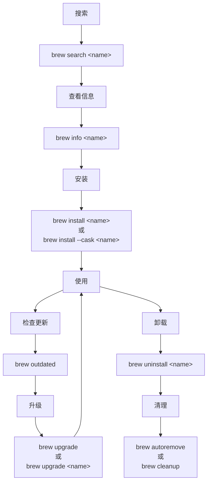

[BrewUI](https://github.com/Homebrew/BrewUI?utm_source=chatgpt.com)

[Homebrew](https://brew.sh)

# Homebrew 命令手册整理

> 来源：Homebrew 官方 `brew(1)` Manual  
> 官方文档：<https://docs.brew.sh/Manpage>
>
> 本文根据上传的 Homebrew `brew(1)` 手册整理，保留官方手册中的核心术语、命令分类和参数说明，不额外引入其他资料。

---

## 1. Homebrew 是什么

Homebrew 是 macOS 等系统上的包管理器，用于安装、升级、卸载和管理软件包。

核心概念：

| 术语                 | 含义                                            |
| -------------------- | ----------------------------------------------- |
| **Formula**          | Homebrew 用于描述软件包的定义文件               |
| **Cask**             | 用于管理 macOS 图形应用及相关软件               |
| **Prefix**           | Homebrew 的安装前缀目录                         |
| **Keg**              | Formula 安装后对应的软件目录                    |
| **Rack**             | 同一个 Formula 不同版本 keg 的集合              |
| **Keg-only**         | 已安装，但不会链接到 Homebrew prefix 的 Formula |
| **Opt prefix**       | 指向某个 Formula 当前版本的稳定路径             |
| **Cellar**           | Formula 安装目录                                |
| **Caskroom**         | Cask 的安装目录                                 |
| **Tap**              | 第三方或额外的 Formula/Cask 仓库                |
| **Bottle**           | Homebrew 预编译的软件包                         |
| **External Command** | 由 Homebrew 扩展提供的额外 `brew` 子命令        |

---

# 2. `brew` 基本命令

## 2.1 查看帮助

```bash
brew help
```

查看 Homebrew 命令帮助。

查看某个命令的帮助：

```bash
brew help install
brew help uninstall
brew help bundle
```

---

## 2.2 安装软件

### Formula

```bash
brew install <formula>
```

例如：

```bash
brew install wget
```

### Cask

```bash
brew install --cask <cask>
```

例如：

```bash
brew install --cask visual-studio-code
```

---

## 2.3 卸载软件

```bash
brew uninstall <formula>
```

Cask：

```bash
brew uninstall --cask <cask>
```

---

## 2.4 查看已安装软件

```bash
brew list
```

查看 Formula：

```bash
brew list --formula
```

查看 Cask：

```bash
brew list --cask
```

查看某个软件安装了哪些文件：

```bash
brew list <formula>
```

---

## 2.5 搜索软件

```bash
brew search <text>
```

例如：

```bash
brew search python
brew search flutter
brew search pm2
```

---

# 3. 软件信息查询

## 3.1 查看 Formula 信息

```bash
brew info <formula>
```

例如：

```bash
brew info python
```

通常可以看到：

- 软件版本
- 软件主页
- 安装路径
- 依赖
- 是否已经安装
- 可用选项等

---

## 3.2 查看 Cask 信息

```bash
brew info --cask <cask>
```

---

## 3.3 查看软件路径

```bash
brew --prefix <formula>
```

例如：

```bash
brew --prefix python
```

也可以查询 Homebrew 本身的 prefix：

```bash
brew --prefix
```

---

## 3.4 查看版本

```bash
brew --version
```

---

# 4. 升级软件

## 4.1 查看哪些软件可以升级

```bash
brew outdated
```

---

## 4.2 升级指定软件

```bash
brew upgrade <formula>
```

---

## 4.3 升级全部软件

```bash
brew upgrade
```

---

# 5. 更新 Homebrew

```bash
brew update
```

这个命令用于更新 Homebrew 自身的 Formula/Cask 元数据。

常见操作：

```bash
brew update
brew outdated
brew upgrade
```

即：

1. 更新 Homebrew 信息
2. 查看可升级软件
3. 执行升级

---

# 6. 清理软件

## 6.1 自动删除不再需要的依赖

```bash
brew autoremove
```

Homebrew 会删除不再被其他已安装 Formula 依赖的 Formula。

---

## 6.2 清理旧版本和缓存

```bash
brew cleanup
```

预览清理内容：

```bash
brew cleanup --dry-run
```

---

# 7. Formula 与 Cask

Homebrew 中常见的软件安装方式可以分为两类。

## Formula

主要用于命令行工具、库和开发环境：

```bash
brew install git
brew install node
brew install python
brew install redis
```

## Cask

主要用于 macOS 图形应用：

```bash
brew install --cask google-chrome
brew install --cask visual-studio-code
```

查看已安装 Cask：

```bash
brew list --cask
```

---

# 8. Tap

Tap 是 Homebrew 的额外软件仓库。

查看当前 Tap：

```bash
brew tap
```

添加 Tap：

```bash
brew tap <user/repo>
```

删除 Tap：

```bash
brew untap <user/repo>
```

Tap 可以让 Homebrew 获得默认仓库之外的 Formula 或 Cask。

---

# 9. Bundle / Brewfile

Homebrew 提供 `brew bundle`，用于通过一个 Brewfile 描述和恢复整个开发环境。

## 9.1 创建 Brewfile

```bash
brew bundle dump
```

它会根据当前 Homebrew 环境生成 Brewfile。

---

## 9.2 使用 Brewfile 安装环境

```bash
brew bundle
```

或者：

```bash
brew bundle --file=<path>
```

---

## 9.3 检查 Brewfile

```bash
brew bundle check
```

用于检查 Brewfile 中声明的软件是否已经安装。

---

## 9.4 查看 Brewfile 中会安装什么

```bash
brew bundle list
```

---

## 9.5 清理 Brewfile 之外的软件

`brew bundle cleanup` 可以根据 Brewfile 检查并清理当前环境中未被 Brewfile 声明的 Homebrew 项目。

建议执行前先使用 dry-run/检查模式确认结果。

---

# 10. Analytics

Homebrew 提供 Analytics 相关命令。

查看 Analytics 状态：

```bash
brew analytics
```

手册中还包含与 Analytics 状态查询、开启和关闭相关的选项。

---

# 11. 常用维护命令组合

## 11.1 更新并升级

```bash
brew update
brew outdated
brew upgrade
```

---

## 11.2 查看并清理旧版本

```bash
brew outdated
brew cleanup
```

---

## 11.3 删除无用依赖

```bash
brew autoremove
```

---

## 11.4 查看当前环境

```bash
brew list
brew list --cask
brew tap
brew --prefix
brew --version
```

---

# 12. 一个比较实用的日常操作流程

如果你的目标是维护 Mac 上的 Homebrew，可以采用：

```bash
# 1. 更新 Homebrew
brew update

# 2. 查看过期软件
brew outdated

# 3. 升级
brew upgrade

# 4. 删除不再需要的依赖
brew autoremove

# 5. 清理旧版本
brew cleanup
```

---

# 13. 软件生命周期

一个 Formula/Cask 常见的管理流程：



---

# 14. macOS 开发环境推荐记忆的核心命令

如果只记最常用的一组：

| 目的             | 命令                         |
| ---------------- | ---------------------------- |
| 查看帮助         | `brew help`                  |
| 搜索             | `brew search <name>`         |
| 查看信息         | `brew info <name>`           |
| 安装             | `brew install <name>`        |
| 安装 App         | `brew install --cask <name>` |
| 卸载             | `brew uninstall <name>`      |
| 查看已安装       | `brew list`                  |
| 查看 Cask        | `brew list --cask`           |
| 更新 Homebrew    | `brew update`                |
| 查看可升级软件   | `brew outdated`              |
| 升级全部         | `brew upgrade`               |
| 升级指定软件     | `brew upgrade <name>`        |
| 查看安装路径     | `brew --prefix <name>`       |
| 删除无用依赖     | `brew autoremove`            |
| 清理旧版本       | `brew cleanup`               |
| 查看 Tap         | `brew tap`                   |
| 生成 Brewfile    | `brew bundle dump`           |
| 按 Brewfile 安装 | `brew bundle`                |
| 检查 Brewfile    | `brew bundle check`          |

---

# 15. Brewfile：适合备份整个开发环境

如果 Mac 上安装了很多开发工具，可以使用：

```bash
brew bundle dump
```

生成 Brewfile。

之后在另一台 Mac 上：

```bash
brew bundle
```

即可根据 Brewfile 重建 Homebrew 环境。

典型用途：

- 新 Mac 初始化
- 重装 macOS 后恢复开发环境
- 多台 Mac 保持一致
- 将开发环境配置纳入 Git 管理

---

# 16. 注意事项

### 16.1 Formula 和 Cask 不要混淆

命令行工具通常：

```bash
brew install <name>
```

macOS GUI 应用通常：

```bash
brew install --cask <name>
```

### 16.2 升级前先查看

推荐：

```bash
brew outdated
```

确认需要升级的软件后，再执行：

```bash
brew upgrade
```

### 16.3 清理操作先确认

对于：

```bash
brew cleanup
brew autoremove
```

如果担心影响现有环境，可以先查看帮助和 dry-run/检查选项，再执行实际清理。

---

# 17. 官方文档

Homebrew 官方 `brew(1)` 手册：

https://docs.brew.sh/Manpage

Homebrew 官方文档：

https://docs.brew.sh/

---

## 说明

这份 Markdown 是对上传的 `brew(1)` HTML 手册进行结构化整理，重点提取了 Homebrew 的核心术语、常用命令、Formula/Cask、Tap、Bundle/Brewfile、Analytics 以及日常维护流程。

原始文档本身属于完整的 `brew(1)` manpage，内容远比这份速查文档详细；这份版本更适合作为 **macOS 上日常使用 Homebrew 的命令手册/速查表**。